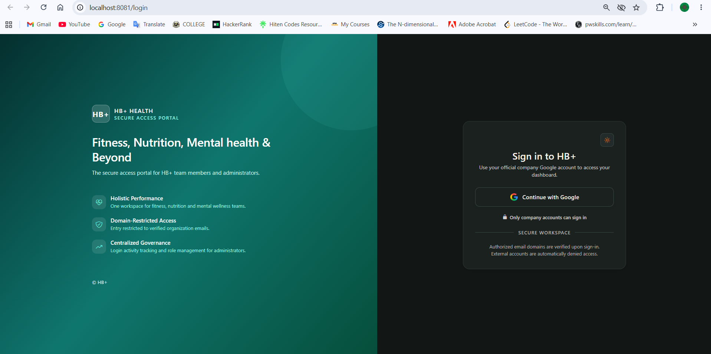
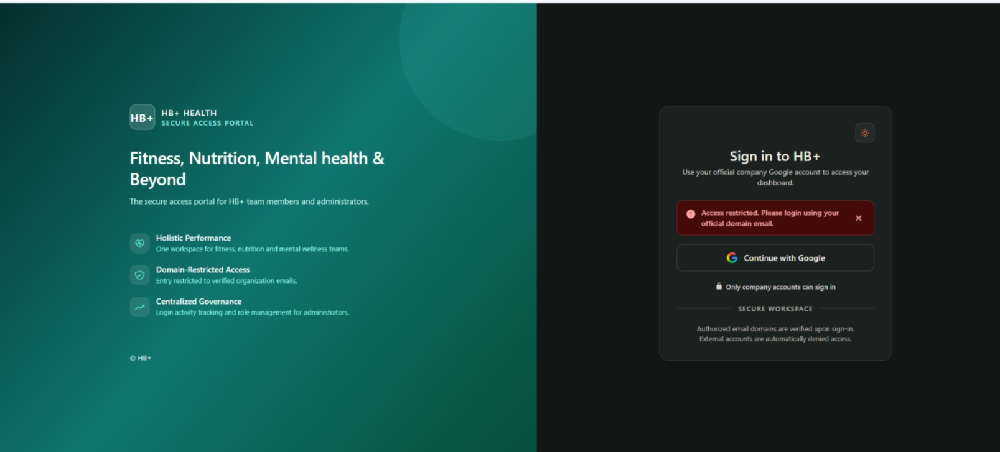
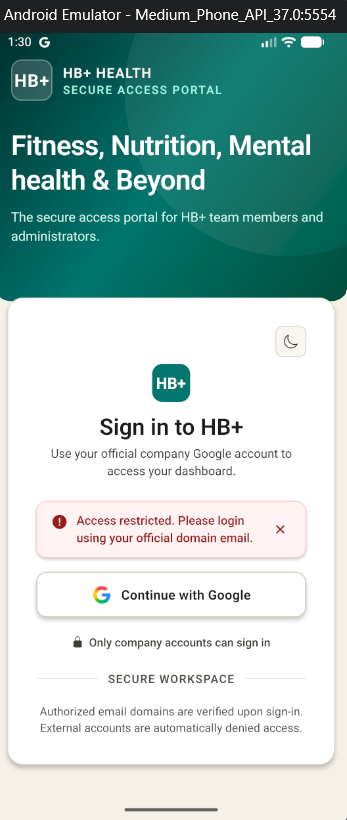
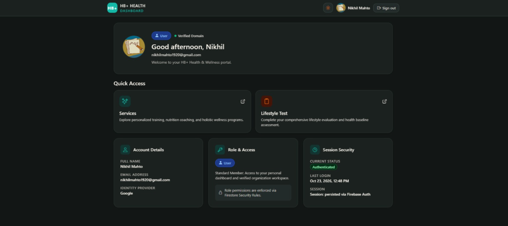
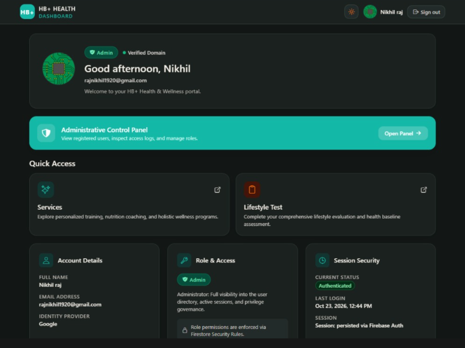
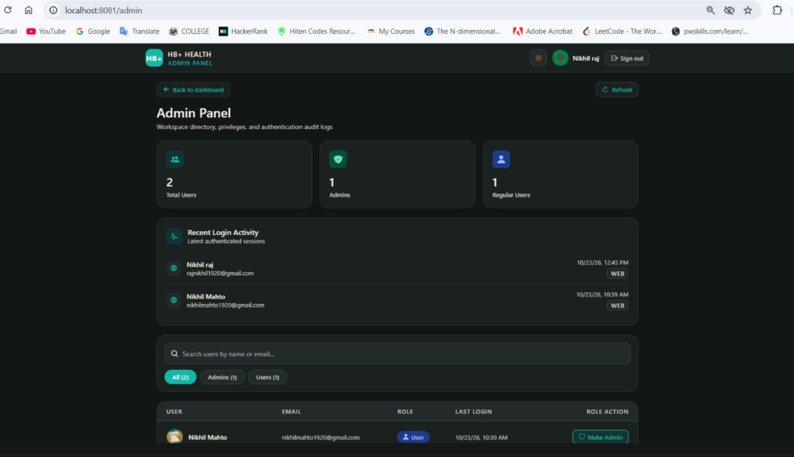
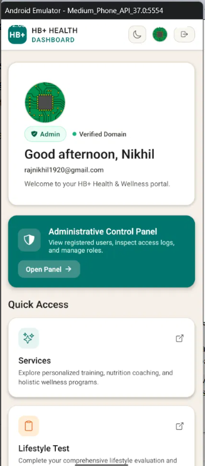

# HB+ Secure Login

A production-ready, cross-platform mobile and web application built with **Expo + React Native + React Native Web** (TypeScript). Users authenticate with Google, and access is strictly restricted to verified corporate accounts belonging to a configurable domain.

The **same codebase** runs across Android, iOS, and modern desktop/mobile web browsers.

---

## Screenshots

The application includes responsive web layouts, native Android experiences, domain guard rejection screens, and role-based dashboards:

| View | Screenshot | Description |
|------|------------|-------------|
| **Login Screen** |  | Responsive split-screen login page featuring wellness branding, feature overview, and branded "Continue with Google" button. |
| **Rejected Login (Web)** |  | Zero-trust domain restriction rejection alert on web: *"Access restricted. Please login using your official domain email."* |
| **Rejected Login (Android)** |  | Mobile domain rejection banner and automatic session purge when logging in with an unauthorized Google account. |
| **User Dashboard** |  | Authenticated standard user dashboard with personalized greeting, profile card, role badge (`user`), and wellness quick links. |
| **Admin Dashboard** |  | Elevated dashboard view for administrators displaying role badge (`admin`) and direct quick-action link to the Admin Panel. |
| **Admin Panel** |  | Governance console with metric cards, recent login activity stream across platforms, and user role management table with confirmation modal and self-protection guard. |
| **Android Emulator** |  | Native Android development build running in an Android Emulator with native Google Play Services authentication. |

---

## Tech Stack

| Layer | Technology | Purpose |
|-------|------------|---------|
| **Framework** | Expo SDK 58, React Native 0.88, React 19 | Cross-platform runtime and component tree |
| **Navigation** | Expo Router | File-based routing with route guards |
| **Authentication** | Firebase Authentication | Google provider with OAuth credential verification |
| **Database** | Cloud Firestore | Real-time NoSQL store with server-side security rules |
| **Native Login** | `@react-native-google-signin/google-signin` | Native Google Sign-In SDK with Google Play Services integration (no redirect URIs) |
| **Web Login** | Firebase `signInWithPopup` | Web popup flow for Google OAuth |
| **Token & State Storage** | `@react-native-async-storage/async-storage` | React Native persistence adapter for Firebase Auth; theme preferences |
| **Styling & UI** | Custom Design System, ThemeContext | Adaptive Light/Dark mode, Ionicons, LinearGradient |
| **Testing** | Jest, `ts-jest` | Automated unit tests for domain restriction logic |
| **Hosting** | Netlify | Static Single Page Application (SPA) deployment |
| **Language** | TypeScript | Strict type safety across the entire application |

---

## Key Features

1. **Zero-Trust Domain Restriction**:
   - Access is restricted to emails ending with the configured corporate domain (`EXPO_PUBLIC_ALLOWED_DOMAIN`, e.g., `hbplus.fit`).
   - Non-compliant logins are blocked with the exact error banner:
     > *"Access restricted. Please login using your official domain email."*
2. **Admin Role Governance**:
   - Administrators can promote or demote users between **User** and **Admin** directly from the Admin Panel.
   - Confirmation dialog prevents accidental role changes.
   - **Self-Protection Guard**: Administrators cannot alter their own role, preventing accidental admin lockouts.
3. **Login Activity Audit Logging**:
   - Every successful login records an audit document in `users/{uid}/logins` with timestamp and platform (`web`, `android`, or `ios`).
   - Admin Panel displays the **Recent Login Activity** widget showing the latest 10 logins across the organization.
4. **Adaptive Light & Dark Themes**:
   - Toggle between warm cream light theme (`#F5F0E8`) and sleek dark wellness theme (`#121615`).
   - Theme preferences persist in local storage across browser reloads and app restarts.
5. **Toast Notifications**:
   - Floating animated feedback for administrative actions and alerts.
6. **30-Minute Idle Session Timeout**:
   - Automatically signs out inactive sessions after 30 minutes of idle time across web interactions and native app state changes.
7. **Friendly 404 Screen**:
   - Polished fallback screen with route redirection for invalid paths.

---

## How Domain Restriction Works

Security operates on a defense-in-depth model across three tiers:

```
[ User initiates Google Login ]
               │
               ▼
   [ 1. Client App Check ] ──────────► Is email_verified == true?
               │                       Does email end with @ALLOWED_DOMAIN?
               │
       ┌───────┴───────┐
       ▼               ▼
   [ Valid ]       [ Invalid ]
       │               │
       │               ▼
       │     [ 2. Auto Sign-Out Guard ]
       │     - Immediate signOut(auth) + GoogleSignin.signOut()
       │     - Purge session state (user = null, role = null)
       │     - Show exact error banner:
       │       "Access restricted. Please login using your official domain email."
       │     - Skip Firestore doc creation
       ▼
   [ 3. Firestore Rules Tier ]
   - Rules regex-match request.auth.token.email against allowed domain
   - Any API call bypassing client code is denied at database level
```

### 1. Client App Check (`src/utils/validateDomain.ts`)
- Verifies `emailVerified === true`.
- Evaluates the email domain against `process.env.EXPO_PUBLIC_ALLOWED_DOMAIN` using case-insensitive validation.
- Rejects unverified accounts, empty values, and lookalike domains (e.g., `user@evilhbplus.fit` or `user@hbplus.fit.com`).
- Does **not** rely on Google's insecure client-side `hd` parameter.

### 2. Auto Sign-Out Guard (`src/context/AuthContext.tsx`)
- On every authentication event and session restoration (`onAuthStateChanged`), the domain check runs immediately.
- If domain validation fails:
  - The app invokes `signOut(auth)` (and `GoogleSignin.signOut()` on native).
  - Auth state is reset to `null`.
  - No user document or login audit entry is written to Firestore.
  - The error banner displays: *"Access restricted. Please login using your official domain email."*
  - Re-entrancy guards prevent double-processing or infinite sign-out loops.

### 3. Server-Side Firestore Security Rules (`firestore.rules`)
- Firestore enforces domain restrictions directly on incoming security tokens:
  ```cel
  function isAllowedUser() {
    return request.auth != null
      && request.auth.token.email_verified == true
      && request.auth.token.email.matches('.*@hbplus[.]fit$');
  }
  ```
- Any unauthorized user who circumvents client-side logic is denied read/write access to `users` and `logins` collections.

---

## Authentication Flow

```
1. User clicks "Continue with Google"
      │
      ├───────────────────────────────┬───────────────────────────────┐
      ▼                               ▼                               ▼
 [Web Platform]               [Android Native]                  [iOS Native]
  signInWithPopup(auth)        GoogleSignin.hasPlayServices()    GoogleSignin.signIn()
                               GoogleSignin.signIn()             (Google ID Token)
                               (Google ID Token)                      │
                                      │                               │
                                      └───────────────┬───────────────┘
                                                      ▼
                                       GoogleAuthProvider.credential(idToken)
                                                      │
                                                      ▼
                                       signInWithCredential(auth, credential)
                                                      │
      ┌───────────────────────────────────────────────┘
      ▼
2. onAuthStateChanged fires with Firebase User
      │
      ▼
3. Domain Validation (validateDomain)
      │
      ├──    Invalid Domain:
      │      1. signOut(auth) + GoogleSignin.signOut()
      │      2. Set error: "Access restricted. Please login using your official domain email."
      │      3. Halt flow (no Firestore records created)
      │
      └──    Valid Domain:
             1. Sync Firestore user doc: users/{uid}
                - First login: create doc (role: "user", timestamps, platform)
                - Later logins: update lastLoginAt and lastPlatform
             2. Write audit log doc to: users/{uid}/logins
             3. Retrieve role ("user" | "admin")
             4. Redirect to /dashboard
```

---

## Firestore Schema

### `users/{uid}`
Stores profile and governance metadata for each allowed user:

| Field | Type | Description |
|-------|------|-------------|
| `uid` | `string` | Firebase Authentication UID |
| `email` | `string` | User's verified Google email address |
| `name` | `string` | Display name from Google profile |
| `photoURL` | `string \| null` | Profile picture URL |
| `role` | `"user" \| "admin"` | Access role (defaults to `"user"` on creation) |
| `createdAt` | `Timestamp` | Server timestamp when the user first logged in |
| `lastLoginAt` | `Timestamp` | Server timestamp of the most recent authentication |
| `lastPlatform` | `string` | Operating system identifier (`web`, `android`, or `ios`) |

### `users/{uid}/logins/{loginId}`
Immutable audit trail written on every successful sign-in:

| Field | Type | Description |
|-------|------|-------------|
| `uid` | `string` | Authenticated user ID |
| `email` | `string` | Authenticated user email |
| `name` | `string` | User display name |
| `platform` | `string` | Platform identifier (`web`, `android`, `ios`) |
| `at` | `Timestamp` | Server timestamp of authentication |

---

## Setup & Local Development

### 1. Prerequisites
- **Node.js** ≥ 18
- **npm** ≥ 9
- **Android Studio** with Android SDK and an Android Virtual Device (AVD)
- A **Firebase** project with Cloud Firestore and Authentication enabled

### 2. Clone & Install
```bash
git clone <repo-url>
cd hbplus-it-intern-assigment
npm install
```

### 3. Firebase & OAuth Configuration

1. **Enable Google Sign-In in Firebase**:
   - Go to [Firebase Console](https://console.firebase.google.com/) → **Authentication** → **Sign-in method** → **Google** → **Enable**.
   - Note down the auto-generated **Web client ID** under *Web SDK configuration*.

2. **Create Firestore Database**:
   - Go to **Firestore Database** → **Create database** (start in test mode or deploy `firestore.rules`).

3. **Configure Google Cloud Credentials**:
   - Go to [Google Cloud Console Credentials](https://console.cloud.google.com/apis/credentials) for your Firebase project.
   - **Android OAuth Client ID**:
     - Application type: **Android**
     - Package name: `com.hbplus.securelogin` (must match `android.package` in `app.json`)
     - SHA-1 Certificate Fingerprint (Debug keystore):
       - **Windows**:
         ```bash
         keytool -list -v -keystore "%USERPROFILE%\.android\debug.keystore" -alias androiddebugkey -storepass android -keypass android
         ```
       - **macOS / Linux**:
         ```bash
         keytool -list -v -keystore ~/.android/debug.keystore -alias androiddebugkey -storepass android -keypass android
         ```
   - **Web OAuth Client ID**:
     - Used by both Web (`signInWithPopup`) and Native (`GoogleSignin.configure({ webClientId })`) to verify Google ID tokens.

### 4. Environment Variables

Copy `.env.example` to `.env`:
```bash
cp .env.example .env
```

Populate `.env` with your project credentials:
```env
# Firebase Web Configuration
EXPO_PUBLIC_FIREBASE_API_KEY=AIzaSy...
EXPO_PUBLIC_FIREBASE_AUTH_DOMAIN=hbplus--login.firebaseapp.com
EXPO_PUBLIC_FIREBASE_PROJECT_ID=hbplus--login
EXPO_PUBLIC_FIREBASE_STORAGE_BUCKET=hbplus--login.firebasestorage.app
EXPO_PUBLIC_FIREBASE_MESSAGING_SENDER_ID=810216969625
EXPO_PUBLIC_FIREBASE_APP_ID=1:810216969625:web:...

# Google OAuth Client IDs
EXPO_PUBLIC_GOOGLE_WEB_CLIENT_ID=810216969625-...apps.googleusercontent.com
EXPO_PUBLIC_GOOGLE_ANDROID_CLIENT_ID=810216969625-...apps.googleusercontent.com
EXPO_PUBLIC_GOOGLE_IOS_CLIENT_ID=your-ios-client-id.apps.googleusercontent.com

# Domain Restriction (change to your domain, e.g. hbplus.fit or gmail.com for testing)
EXPO_PUBLIC_ALLOWED_DOMAIN=hbplus.fit
```

### 5. Deploy Firestore Security Rules

Deploy the multi-tier security rules using the Firebase CLI:
```bash
npm install -g firebase-tools
firebase login
firebase deploy --only firestore:rules
```

---

## Running the Application

### Web
```bash
npm run web
```
Opens the application in your default browser at `http://localhost:8081`.

### Android (Requires Development Build)
> [!IMPORTANT]
> **Android requires a native development build**.
> Because `@react-native-google-signin/google-signin` uses native Android Java/Kotlin code and Google Play Services libraries, it **cannot** run inside standard Expo Go. You must build and run the native binary on an emulator or connected device.

Run the Android development build command:
```bash
npx expo run:android
```
This compiles the Android project with the `@react-native-google-signin/google-signin` config plugin and launches it in your active Android emulator.

### Automated Tests & Typecheck
```bash
# Run Jest unit test suite
npm test

# Run TypeScript check
npm run typecheck

# Build and export static web assets
npm run build:web
```

---

## Deployment to Netlify

The web version is fully configured for continuous deployment on https://hbplus-secure-login.netlify.app

### Configuration Details
- **Build command**: `npx expo export -p web` (or `npm run build:web`)
- **Publish directory**: `dist`
- **SPA Routing**: Handled via `netlify.toml` and `public/_redirects`:
  ```toml
  [build]
    command = "npx expo export -p web"
    publish = "dist"

  [[redirects]]
    from = "/*"
    to = "/index.html"
    status = 200
  ```

### Steps to Deploy
1. Push your repository to GitHub / GitLab / Bitbucket.
2. In Netlify, click **Add new site** → **Import an existing project**.
3. Select your repository.
4. Set build settings:
   - **Build command**: `npx expo export -p web`
   - **Publish directory**: `dist`
5. Under **Site configuration** → **Environment variables**, add all `EXPO_PUBLIC_*` variables from your `.env` file.
6. In **Firebase Console** → **Authentication** → **Settings** → **Authorized domains**, add your Netlify domain (e.g., `your-site.netlify.app`).
7. Click **Deploy site**.

---

## Folder Structure

```
├── app/
│   ├── _layout.tsx              # Root: ThemeProvider + AuthProvider + ToastProvider + useIdleTimeout
│   ├── login.tsx                # Responsive Split Login Screen with branding and error banner
│   ├── +not-found.tsx           # Friendly 404 Route Redirection Screen
│   └── (app)/
│       ├── _layout.tsx          # Authenticated slot wrapper
│       ├── dashboard.tsx        # User/Admin Dashboard (greeting, metrics, admin CTA)
│       └── admin.tsx            # Admin Panel (stats, recent logins, user role management)
├── src/
│   ├── config/
│   │   ├── firebase.ts          # Firebase singleton & AsyncStorage persistence
│   │   └── allowedDomain.ts     # Configurable allowed domain constant
│   ├── context/
│   │   ├── AuthContext.tsx      # Auth lifecycle, GoogleSignin, domain check & Firestore user sync
│   │   ├── ThemeContext.tsx     # Adaptive Light/Dark mode state and persistence
│   │   └── ToastContext.tsx     # Animated toast notification manager
│   ├── hooks/
│   │   └── useIdleTimeout.ts    # 30-minute idle inactivity auto-signout hook
│   ├── utils/
│   │   ├── validateDomain.ts    # Pure domain validation logic
│   │   └── __tests__/
│   │       └── validateDomain.test.ts # Jest unit tests for domain restriction
│   ├── services/
│   │   └── userService.ts       # Firestore CRUD, user sync, role updates, login audit logs
│   ├── components/
│   │   ├── AppHeader.tsx        # Shared header component with profile and theme controls
│   │   ├── Avatar.tsx           # Photo avatar with initials fallback
│   │   ├── Badge.tsx            # Role badges (Admin / User)
│   │   ├── ErrorBanner.tsx      # Animated dismissible error alert
│   │   ├── GoogleButton.tsx     # Styled Google button with loading spinner
│   │   ├── Loader.tsx           # Centered brand loading indicator
│   │   └── Skeleton.tsx         # Animated loading placeholders
│   └── theme.ts                 # Design tokens (colors, spacing, typography, radii, shadows)
├── firestore.rules              # Multi-tier Firestore security rules
├── jest.config.js               # Jest configuration with ts-jest preset
├── netlify.toml                 # Netlify deployment and SPA redirect configuration
├── public/_redirects            # SPA fallback for web hosting
├── .env.example                 # Example environment variables
├── app.json                     # Expo configuration and plugins
├── package.json
└── tsconfig.json
```
